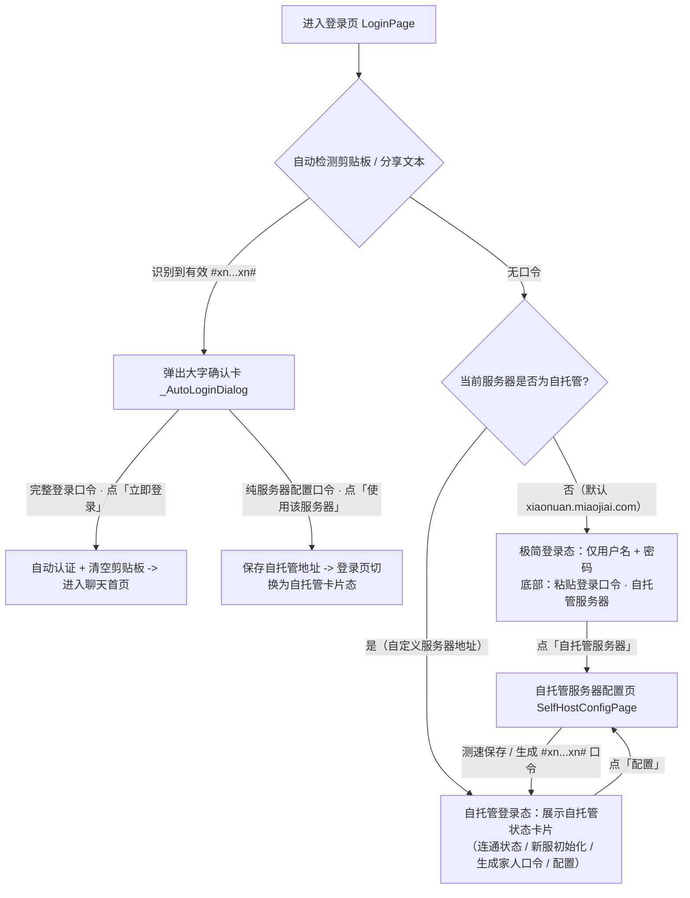

# v5 方案：零配置默认登录、自托管模式与 `#xn...xn#` 免输加密口令

> 2026-11-18 定稿。面向「异地子女配置、父母零门槛使用」与「官方默认服务 + 私有自托管双轨并存」场景重构登录与家庭分发链路。

## 1. 背景与核心痛点

小暖的核心用户是家里的长辈（父母、爱人），而部署与管理账号的人通常是子女。旧版登录页把「服务器地址」「用户名」「密码」三个输入框平铺在首屏，在实际家庭使用中暴露出两个突出痛点：

1. **绝大多数默认服务用户被迫理解「服务器地址」**：普通用户并不知道什么是域名、端口或 `https://`，多出的必填框既增加理解成本，也容易因误填空格、中文句号导致连接失败。
2. **异地父母手动输入配置与随机密码极易受挫**：管理员给父母建好账号后，过去只能发一段明文（服务器 + 英文用户名 + 8 位随机密码）。异地父母需要在微信与小暖之间反复切屏对照输入，遇到切换大小写、相近字符或长域名时门槛极高，且明文密码长期留在聊天记录里也不够体面。

### 已拍板的工程决策

1. **默认服务器内置为 `https://xiaonuan.miaojiai.com`，首屏彻底去掉服务器输入框。**
   - 新装打开默认连接官方服务，登录页只保留「用户名」「密码」与「登录」主按钮，认知负担降到最低。
   - 老版本升级用户若本地已保存自定义服务器地址，自动保留并归入「自托管模式」，升级零感知、不断连。
2. **自托管抽离为独立配置页，配置后在首页透出自托管能力。**
   - 登录页底部提供克制的「自托管服务器」入口，点击进入独立的 **自托管服务器配置界面**（支持官方默认 / 自托管双模式切换、实时连通性与延迟测试、未初始化新服引导 `SetupPage`、直接生成家人免输口令）。
   - 一旦切换为自托管地址：
     - **登录首页**自动展示「自托管服务器」状态卡片（含域名、在线状态、新服初始化入口、配置切换与生成家人口令快捷操作）；
     - **聊天首页（`Welcome` 欢迎页与左侧抽屉）**展示温润的「自托管 · `<域名>`」能力胶囊，点击可查看私有部署状态并一键为家人生成免输登录口令；默认官方服务下不渲染该胶囊，保持 0 视觉噪音。
3. **采用 App 专属认证对称加密协议（`#xn<密文>xn#`），无需服务端改表，全版本兼容。**
   - 口令不是裸 Base64（裸 Base64 在任意解码工具下等同明文，且被截断后会产生乱码账号密码），而是采用 **RFC 8439 ChaCha20 流加密 + HMAC-SHA256 认证标签（Encrypt-then-MAC）**，配合随机 96-bit Nonce 与无填充 Base64Url 编码。
   - 支持两种载荷粒度：
     - **完整一键登录口令**（含服务器 + 用户名 + 密码 + 可选称呼）：父母复制后打开小暖，弹出大字确认卡，**点一下「立即登录」即自动完成认证进入首页**，全程零打字；
     - **纯自托管服务器配置口令**（仅含服务器地址）：适合群发给已知自己账号的家庭成员，一键切换服务器。
   - 认证直接复用标准 `POST /api/auth/login`，无需修改服务端数据库结构，100% 兼容 `xiaonuan.miaojiai.com` 及所有已部署的 `nuan-server` 实例。
4. **剪贴板自动识别兼顾隐私边界与国产系统防呆。**
   - **仅在未登录的 `LoginPage` 进入或从后台切回前台（`resumed`）时读取剪贴板**，登录后的日常聊天绝不触碰剪贴板，避免 Android 12+ / iOS 16+ 频繁弹出「小暖读取了剪贴板」系统提示。
   - 同时接入系统文本分享通道（`incomingShareProvider`），长辈在微信长按消息选「更多 → 分享给小暖」同样能直接触发口令识别。
   - 登录页底部常驻「粘贴登录口令」按钮：若部分手机系统拦截了静默读取剪贴板，长辈点一下即可主动读取或粘贴识别。

---

## 2. `#xn...xn#` 专属对称加密协议规范

### 2.1 文本封装格式

口令固定以 `#xn` 开头、`xn#` 结尾，中间为无 `=` 填充的 `Base64Url` 字符集（仅含 `A-Z`、`a-z`、`0-9`、`-`、`_`，不含 `/`、`+`、`=`，防止微信或短信把密文误识别为半截网页链接）：

```text
【小暖一键登录】
妈妈，复制整段消息后打开「小暖」App，会自动弹出登录提示，点一下就能直接用啦：
#xnAbCdEfGhIjKlMnOpQrStUvWxYz0123456789-_...xn#
```

解析器通过正则 `#xn([\s\S]+?)xn#` 从任意自然语言段落中提取密文体，并自动剔除微信转发或换行可能混入的空白符、换行符与零宽字符（`\u200B` / `\uFEFF`）。若检测到剪贴板含有 `#xn` 前缀但缺失结尾 `xn#`，明确提示长辈「口令好像没复制全，请回微信长按整条消息点复制」。

### 2.2 二进制帧与密码学构造（XN1）

```text
+------------+------------------+----------------------+-----------------------+
| Header(1B) | Nonce / IV (12B) | Ciphertext (N Bytes) | HMAC-SHA256-128 (16B) |
+------------+------------------+----------------------+-----------------------+
```

| 字段 | 长度 | 说明 |
|---|---|---|
| `Header` | `1 Byte` | 低 7 位为协议版本号（当前 `0x01`）。遇到未知高版本时友好提示「请先升级小暖 App」。 |
| `Nonce` | `12 Bytes` | 每次生成时由 `Random.secure()` 产生的 96-bit 密码学安全随机数；同一账号重复生成也会得到完全不同的口令文本。 |
| `Ciphertext` | `N Bytes` | 明文 UTF-8 JSON 经 **RFC 8439 ChaCha20**（`counter = 1`）流加密后的密文。 |
| `MAC Tag` | `16 Bytes` | 对 `Header \|\| Nonce \|\| Ciphertext` 计算 `HMAC-SHA256` 后截取前 128 bit，解密前使用常数时间比对（Constant-time compare），任何单字符损坏或篡改立即拦截。 |

**子密钥派生（HKDF 域分离）**：
由客户端内置的 256-bit 应用根密钥 $K_{\text{root}}$ 结合单次随机 `Nonce` 派生互不相关的加密子密钥与认证子密钥：
- $K_{\text{enc}} = \text{HMAC-SHA256}(K_{\text{root}}, \text{"xn-invite-v1/enc"} \parallel \text{Nonce})$
- $K_{\text{mac}} = \text{HMAC-SHA256}(K_{\text{root}}, \text{"xn-invite-v1/mac"} \parallel \text{Nonce})$

### 2.3 紧凑载荷定义

明文 JSON 采用短键名以最短化微信消息体积：

```json
{
  "s": "",
  "u": "mama",
  "p": "k9m2x7p4",
  "n": "妈妈",
  "t": 1795054800
}
```

- `s`（可选）：规范化后的服务器地址。**当目标为官方默认地址 `https://xiaonuan.miaojiai.com` 时省略该字段**，使默认服务的完整登录口令总长控制在约 **90 个字符**以内（微信气泡仅占 2～3 行）。
- `u` / `p`（可选）：登录用户名与密码。同时存在时为「一键自动登录口令」；均省略且 `s` 非空时为「自托管服务器配置口令」。
- `n`（可选）：家人称呼（如 `妈妈`），用于弹窗亲切问候「你好，妈妈！」。
- `t`（可选）：生成时间戳（秒）。不设短效硬过期（异地父母可能隔天甚至几天后才看到微信消息并打开 App），密码变更时由服务端自然失效。

### 2.4 安全模型与边界说明

- **防护目标**：消除微信/短信聊天记录明文密码留存、防止截屏 OCR 泄露、防止输入法/剪贴板关键词抓取「密码：xxx」、并通过 128-bit MAC 杜绝复制残缺导致的乱码请求。
- **客观边界与配套纵深防御**：由于离线客户端在未登录前需本地解密口令，内置对称密钥无法抵御针对安装包本身的刻意逆向分析。为此配套三项保护：
  1. **用后即焚剪贴板**：父母点击「立即登录」一旦成功，App 立即清空系统剪贴板中的口令并记录口令指纹，防止其他后台应用事后窥探剪贴板，也防止日后退出登录时死循环重弹；
  2. **确认后再发网**：识别口令后先弹出清晰的卡片展示账号与目标服务器（自托管域名透明可见），由用户点按确认后才发起网络请求，杜绝剪贴板静默 SSRF；
  3. **服务端随时可控**：管理员在「家庭成员」中重置密码或停用账号后，旧口令立即失效。

---

## 3. 页面重构与交互流程



### 3.1 登录页双态设计（`app/lib/ui/login_page.dart`）

1. **默认官方服务态（`server == https://xiaonuan.miaojiai.com`）**：
   - 隐藏服务器输入框，仅展示吉祥物问候、「用户名」、「密码」及「登录」按钮；
   - 若官方服务器处于全新未初始化状态（`needs_setup == true`），仍自动浮现初始化引导卡；
   - 底部对称排布两个轻量入口：**「粘贴登录口令」** 与 **「自托管服务器」**（触控热区均 ≥ 44dp）。
2. **自托管服务态（`isSelfHosted == true`）**：
   - 在表单顶部展示 **自托管服务卡片**：
     - 显示「自托管服务器」徽标、当前连接域名（如 `chat.myhome.com`）、实时连通性徽标（检测中 / 已连通 / 无法连接）；
     - 右侧提供「配置」按钮进入 `SelfHostConfigPage`；
     - 卡片底部提供 **「生成家人免输口令」** 与 **「切回默认」** 快捷操作；
     - 若检测到该自托管服务器尚未创建管理员（`needs_setup == true`），紧接展示醒目的「这台服务器还没有管理员 · 点这里完成初始化」入口。

### 3.2 自托管服务器配置界面（`app/lib/ui/self_host_page.dart`）

- **服务来源切换**：以直观双卡片呈现「官方默认服务（`xiaonuan.miaojiai.com`，免配置）」与「自托管服务器（连接自家 NAS 或私有云）」。
- **地址配置与实时诊断**：
  - 支持裸填 IP:端口或域名（`normalizeServer` 自动补全 `http://` 内网或 `https://` 公网协议）；
  - 内置快捷「粘贴」胶囊与一键「测试连接」，实测返回 `/healthz` 耗时（毫秒）及是否需要首次初始化；
  - 若检测到全新未初始化服务器，可直接从配置页一键跳转 `SetupPage` 完成管理员初始化。
- **配置完成即分享**：页面内置「生成家人免输口令」卡片，部署者配好地址后可当场填入父母的账号密码（支持先一键验证账号密码正确性），生成 `#xn...xn#` 加密口令复制给父母。
- **本机防误弹保护**：在本机生成并复制口令时自动标记该口令指纹为「本机生成」，返回登录页时不会对自己弹出父母的自动登录框（手动点「粘贴登录口令」仍可随时测试）。

### 3.3 首页与管理端的自托管能力透出

1. **聊天首页欢迎视图（`app/lib/ui/welcome.dart`）与侧边栏（`app/lib/ui/drawer.dart`）**：
   - 当 `session.isSelfHosted == true` 时，`Welcome` 问候语下方展示温润的 **「自托管 · `<域名>` · 邀请家人」** 胶囊，侧边栏标题「小暖」旁展示轻量 `自托管` 标签；
   - 点击胶囊弹出 **自托管服务详情面板**：清晰说明当前对话与记忆均存储在私有服务器，并提供「生成家人免输口令」及管理员快捷入口（「家庭成员」「模型与供应商」）。
2. **家庭成员管理（`app/lib/ui/admin_page.dart`）与设置页（`app/lib/ui/settings_page.dart`）**：
   - 管理员新建家人账号或重置密码后，自动弹出升级版口令分享卡：**默认主推一键复制 `#xn...xn#` 微信引导文案**，同时保留可展开查看的传统明文信息；
   - 家庭成员操作菜单新增「生成免输登录口令」；
   - 「设置 → 关于 → 服务器」清晰标注「官方默认」或「自托管 · `<域名>`」，点击即可打开服务器说明与口令生成器。

---

## 4. 代码落点与升级兼容

| 模块 | 文件路径 | 核心职责 |
|---|---|---|
| 默认地址与加密口令协议 | `app/lib/core/invite_code.dart` | `kDefaultServer` 常量、RFC 8439 ChaCha20 + HMAC-SHA256 加解密、`#xn...xn#` 提取/封装、本机防误弹与已消费指纹记录 |
| 会话状态与服务器持久化 | `app/lib/state/session.dart` | `configuredServer`（空值回退 `kDefaultServer`）、`isSelfHosted`、`setServer()` 实时切换并持久化 |
| 自托管配置与口令生成面板 | `app/lib/ui/self_host_page.dart` | `SelfHostConfigPage` 配置页、`showInviteGeneratorSheet` 口令生成弹窗、`showSelfHostInfoSheet` 首页自托管能力面板 |
| 登录页重构与自动登录弹窗 | `app/lib/ui/login_page.dart` | 默认极简态 / 自托管卡片态、生命周期剪贴板与分享监听、半截口令容错提示、`_AutoLoginDialog` 一键自动登录 |
| 首页与管理端联动 | `app/lib/ui/welcome.dart`<br>`app/lib/ui/drawer.dart`<br>`app/lib/ui/admin_page.dart`<br>`app/lib/ui/settings_page.dart` | 聊天首页与侧栏自托管徽标及面板入口、管理员建号/重置密码直出 `#xn...xn#` 口令、设置页服务器详情联动 |
| 单元测试与组件测试 | `app/test/login_self_host_test.dart` | RFC 8439 标准向量校验、加解密往返与篡改拦截、微信长文本提取、默认/自托管双态 UI、剪贴板自动弹窗一键登录全流程测试 |

### 存量用户升级兼容性

- **已登录老用户**：`SharedPreferences` 中已有 `server` 与 `token`，升级后直进首页；若原 `server` 不是 `https://xiaonuan.miaojiai.com`，自动识别为 `isSelfHosted = true` 并在首页展示自托管胶囊。
- **未登录新用户**：`server` 为空时自动取 `https://xiaonuan.miaojiai.com`，首屏零配置直接输入账号密码或识别 `#xn...xn#` 登录。

---

## 5. 验收清单

- [x] 全新安装进入登录页默认连接 `https://xiaonuan.miaojiai.com`，首屏无服务器地址输入框。
- [x] 点击「自托管服务器」可配置私有地址、测试连通性与延迟、引导新服初始化，保存后登录页与聊天首页均清晰展示自托管状态与能力，也可随时一键切回官方默认。
- [x] `#xn...xn#` 采用 ChaCha20 + HMAC-SHA256 对称认证加密，同一配置多次生成密文不同，任意篡改或截断均可精准拦截并给出适老化提示。
- [x] 管理员创建账号、重置密码，或在自托管配置页 / 首页自托管面板中均可一键复制带引导话术的 `#xn...xn#` 口令。
- [x] 异地父母复制整段微信消息后进入（或切回）登录页，自动弹出大字确认卡，点按「立即登录」即自动完成登录并清理剪贴板，且本机刚生成的口令与已消费口令绝不重复骚扰弹窗。
