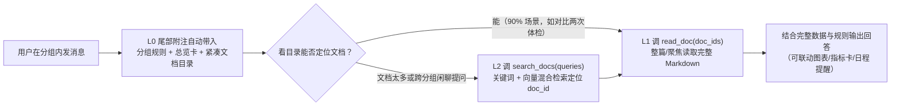

# v9 方案草案：专注分组（Spaces）与轻量级虚拟资料库（Notebook）

> **状态：需求与技术方案草案（待评审定稿）**
> 本文整理「小暖集成类似 `financial-management` / NotebookLM / Claude Projects 的持续资料积累与查阅能力」的完整产品需求、轻量级技术架构与**待拍板决策清单（第 7 节）**，供后续逐项沟通敲定。

---

## 1. 背景与核心目标

### 1.1 痛点与诉求
小暖在 v3 已经具备了「跨模型原子记忆」（记住一句句短事实，如过敏史、家人生日、口味偏好），但在面对**资料越积越多、需要完整保留上下文并反复查阅对比**的垂直场景时，一句话记忆就不够用了：

- **健康管理**：一年几次的体检报告、历次化验单指标、门诊病历、长期用药调整记录、父母慢病档案。如果只抽成几句短记忆，具体数值、参考区间和日期会丢失；如果只留在老聊天记录里，隔几个月再问就淹没在历史会话中难以对齐比较。
- **文档与生活资料管理**：家里净水器/热水器/路由器的说明书、换滤芯步骤、证件/保单关键条款、旅游攻略、家庭办事材料清单。这些内容平时不用，要用时需要**精准查到原文甚至回看当时拍的原图**。
- **专项长期事务**：家庭账本/理财纪律、装修跟进、孩子学习错题与阶段总结等，需要 AI 遵循一套专属规则，并在同一个资料池上持续累加材料。

### 1.2 灵感对标与小暖的取舍

| 对标对象 | 核心长处 | 为什么不能照搬 | 小暖吸收什么 |
|---|---|---|---|
| **Google NotebookLM** | 围绕指定资料库问答，有据可查、不胡编 | 偏「人手动上传一堆静态文档 → AI 只读问答」，缺少日常聊天顺手沉淀资料的闭环，且交互偏桌面研究工具 | **分组资料聚焦 + 引用溯源（可点开原文档与原图）** |
| **Claude / ChatGPT Projects** | 按主题隔离对话、自定义指令与背景文档 | 文档主要靠用户手工维护，AI 不能在聊天中帮老人自动建档、更新状态或追加记录 | **「专注分组 = 专属规则 + 专属资料夹 + 专属对话列表」的产品容器** |
| **`financial-management` 仓库** | 靠「总览索引 + 状态文档与流水记录分离 + 硬性纪律」实现资料越积越多却极度清晰，零重型基础设施 | 基于本地 Git 仓库 + CLI 脚本，只有开发者能用 | **三级渐进查阅（先看目录再翻全文）、`state`（覆盖更新）与 `log`（只增不改）双文档模式、专属规则约束** |

### 1.3 四条核心设计原则
1. **极度轻量，不引重组件**：不映射服务器宿主机真实文件夹，不引入外部向量数据库、Elasticsearch 或复杂文档排版解析服务；虚拟文档全部落在现有的 SQLite / Postgres 双库体系内，备份依然是拷走一个数据目录。
2. **不做碎块切片 RAG，采用「三级渐进查阅」**：传统切片 RAG 会把体检表、说明书步骤切碎导致张冠李戴或漏行。小暖采用 **「L0 目录索引常驻 → L1 按需整篇/按章精读 → L2 混合检索兜底」**。
3. **100% 保住上游前缀缓存**：完全复用 v7 Skills 按需工具引擎与尾部系统附注机制，**绝不动态改写 `Messages[0]`**，日常普通闲聊零额外 Token 开销。
4. **保持适老化「小暖味」**：绝不做成 Notion 或多级文件夹管理器；对家人来说，它只是一个**「带资料袋的专属聊天空间」**——拍张照、说句话就能把资料存进去，随时问都能翻出来。

---

## 2. 产品形态与核心交互

### 2.1 核心概念：专注分组（Space）
一个「专注分组」由三部分组成：
1. **分组设定（名称 + 图标 + 专属规则 `rules_md`）**：决定小暖在这个分组里怎么说话、遵守什么底线。
2. **虚拟资料夹（`space_docs` + 总览卡 `overview_md`）**：存放沉淀下来的结构化 Markdown 文档及关联的原始照片/附件。
3. **分组内对话流**：在该分组下发起的对话自动归属此分组，天然共享该分组的总览卡与资料夹。

### 2.2 内置开箱模板（一键开通）

为降低使用门槛，新建分组时提供预设模板（也支持空白自定义）：

| 模板 | 默认图标与名称 | 预设文档分类建议 | 预设专属规则（`rules_md` 核心精神） | 空白欢迎页快捷引导示例 |
|---|---|---|---|---|
| `health` | 🩺 **健康管理** | `核心档案`、`体检报告`、`就诊与化验`、`用药记录` | 数字与指标必须核对文档日期，严禁凭记忆编造数值；给饮食/用药建议前先查当前用药与过敏史；区分医学科普与就医提醒 | 「拍张化验单帮我解读并存档」「对比最近两次体检异常项」「看看我现在吃哪些药」 |
| `docs` | 📄 **资料与说明书** | `家电说明书`、`家庭设备与网络`、`证件与保单`、`办事指南` | 优先依据资料夹内文档步骤回答并注明出处文档；涉及型号、滤芯规格、保修期等细节必须核对原文或原图 | 「拍一张家电说明书存起来」「家里净水器怎么换滤芯？」「查一下已存的保修和证件信息」 |
| `ledger` | 📒 **账单与规划** | `纪律与目标`、`月度记录`、`大额支出`、`比价备忘` | 事实数据与分析建议分开；算账列清口径与日期；涉及历史流水只追加不篡改 | 「记一笔今天的大额开支」「汇总一下最近记过的账目」 |
| `custom` | ✨ **自定义分组** | 用户/模型自由归类 | 用户用一句话描述用途（如「装修跟进」「孩子三年级学习」「爸妈健康档案」），自动生成简明规则 | 根据分组描述动态展示 |

### 2.3 客户端交互动线（保持极简）

1. **侧边栏入口（`drawer.dart`）**：
   - 在侧边栏「新对话」按钮下方新增紧凑的 **「专注分组」** 区域（横向胶囊或折叠列表 + `＋` 号）。
   - 点某个分组即进入该分组的专属视图；长按可编辑分组名、专属规则或归档删除；历史聊天记录可按「全部 / 当前分组」过滤。
2. **分组主界面 = 聊天窗 + 右上角「资料夹」胶囊**：
   - 进入分组后，主界面依然是家人最熟悉的对话页，顶部栏显示分组图标与名称（如 `🩺 健康管理`），右侧放一个醒目的 **`资料夹 (12)`** 按钮（大字号、≥44dp 触控区）。
   - 在分组内点「新对话」，开启的新会话自动绑定当前 `space_id`。
3. **资料写入的两条路径**：
   - **路径 A：对话中顺手存（主力路径）**
     用户在分组里拍照发化验单、说明书，或口述「今天去医院复查，尿酸降到 390 了，医生让非布司他改成隔天吃」。小暖一边正常回答（可配合 v8 `show_metrics` / `show_chart` 展示卡片），一边调用工具把内容归档进资料夹，气泡上方展示柔和步骤条：
     `📁 已存入健康管理：《2026-11-21 复查与用药调整》 [查看]`
   - **路径 B：资料夹内点「＋ 存资料」（主动导入）**
     支持 **① 拍照/选相册图片提取建档**、**② 粘贴文字/微信长消息建档**、（可选 ③ 选手机里的 PDF/TXT/MD 文件导入），后台用轻量模型自动整理为带标题、日期、一句话摘要与清晰小标题的 Markdown 文档，并保留原图关联。
4. **资料夹浏览与编辑页（`space_docs_page.dart`）**：
   - 顶部展示置顶的 **「📌 分组总览」** 卡片（一屏看清核心现状）。
   - 下方按分类（如 `体检报告`、`用药记录`）与日期倒序排列文档卡片，支持顶部搜索框秒搜。
   - 点开任意文档：上方可滑动查看**关联的原始照片**（点击放大看高清化验单/说明书原图），下方以大字号渲染整理好的 Markdown，支持手动修改标题/正文、改分类、置顶或删除。

---

## 3. 核心技术架构设计

### 3.1 与 v3「跨模型共享记忆」的边界划分（防重叠、防打架）

| 维度 | v3 全局原子记忆（`memories`） | v9 专注分组资料库（`spaces` + `space_docs`） |
|---|---|---|
| **颗粒度** | 单句短事实（≤80 字，如「对青霉素过敏」「患有高血压」） | 完整结构化长文档（几百～上万字，含表格、分步指南、完整指标、原图关联） |
| **生效范围** | 全局所有非隐私对话常驻/检索 | 以所属专注分组为主（普通对话仅在需要时通过搜索工具跨组调阅） |
| **写入方式** | 每轮对话结束后后台静默抽取 | 分组对话中模型显式调工具归档，或用户主动点「＋ 存资料」导入 |
| **协同原则** | 跨对话都必须时刻记住的保命底线（如药物过敏、基础慢病）仍由 v3 保底常驻；具体的历次化验单全文、说明书步骤放在 v9 `space_docs`，互不替代 |

### 3.2 数据库模型（迁移 `015_spaces_and_docs.sql`，SQLite & Postgres 双库对齐）

延续小暖现有规范：主键统一 UUIDv7 字符串，时间戳统一毫秒级 `BIGINT`，布尔值存 `0/1` 整数，向量编码复用 `store.EncodeEmbedding`（小端 `float32` `BLOB` / `BYTEA`）。

```sql
-- 1. 专注分组表
CREATE TABLE spaces (
  id          TEXT PRIMARY KEY,                  -- UUIDv7
  user_id     TEXT NOT NULL REFERENCES users(id) ON DELETE CASCADE,
  kind        TEXT NOT NULL DEFAULT 'custom',    -- health | docs | ledger | custom
  name        TEXT NOT NULL,
  icon        TEXT NOT NULL DEFAULT '📁',
  description TEXT NOT NULL DEFAULT '',
  rules_md    TEXT NOT NULL DEFAULT '',          -- 分组专属规则与角色约束
  overview_md TEXT NOT NULL DEFAULT '',          -- 分组总览卡（类似 financial-management 的 README 当前状态）
  sort        INTEGER NOT NULL DEFAULT 0,
  archived    INTEGER NOT NULL DEFAULT 0,
  created_at  INTEGER NOT NULL,
  updated_at  INTEGER NOT NULL
);
CREATE INDEX spaces_user_sort ON spaces(user_id, archived, sort, updated_at DESC);

-- 2. 分组虚拟文档表（不映射宿主机真实文件）
CREATE TABLE space_docs (
  id              TEXT PRIMARY KEY,              -- UUIDv7
  space_id        TEXT NOT NULL REFERENCES spaces(id) ON DELETE CASCADE,
  user_id         TEXT NOT NULL REFERENCES users(id) ON DELETE CASCADE,
  category        TEXT NOT NULL DEFAULT '未分类', -- 分组内二级目录名（如 体检报告 / 家电说明书）
  title           TEXT NOT NULL,
  summary         TEXT NOT NULL DEFAULT '',      -- ≤80 字一句话摘要，专供拼装 L0 目录索引
  content         TEXT NOT NULL DEFAULT '',      -- 结构化 Markdown 正文
  doc_mode        TEXT NOT NULL DEFAULT 'log',   -- state（状态覆盖型） | log（流水记录型）
  file_ids        TEXT NOT NULL DEFAULT '[]',    -- JSON 数组：关联的 files.id（化验单/说明书原图等）
  source          TEXT NOT NULL DEFAULT 'chat',  -- chat（对话归档） | upload（手动导入） | manual（手动新建）
  source_conv_id  TEXT REFERENCES conversations(id) ON DELETE SET NULL,
  pinned          INTEGER NOT NULL DEFAULT 0,
  event_at        INTEGER NOT NULL,              -- 资料实际发生日期（如体检日期 2026-05-12，默认等于 created_at）
  keywords        TEXT NOT NULL DEFAULT '',      -- 检索同义词/型号/指标名，空格分隔
  embedding       BLOB,                          -- 复用 bge-m3 向量（对 title + summary + keywords + 截断正文编码）
  embedding_model TEXT NOT NULL DEFAULT '',
  created_at      INTEGER NOT NULL,
  updated_at      INTEGER NOT NULL
);
CREATE INDEX space_docs_space_cat ON space_docs(space_id, pinned DESC, event_at DESC);
CREATE INDEX space_docs_user ON space_docs(user_id, updated_at DESC);

-- 3. 会话关联分组（NULL = 普通全局对话）
ALTER TABLE conversations ADD COLUMN space_id TEXT REFERENCES spaces(id) ON DELETE SET NULL;
CREATE INDEX conversations_user_space ON conversations(user_id, space_id, updated_at DESC);
```

> **两个必须同步修改的底层细节（防踩坑）：**
> 1. **图片孤儿回收保护（`server/internal/store/images.go`）**：现有 `referencedFileIDsSQL()` 只扫描 `messages.attachments`。一旦图片被归档进 `space_docs.file_ids`，即使家人后来删掉了当时的旧聊天会话，后台定时清理也**绝不能**删除这张化验单/说明书原图——需在 `referencedFileIDsSQL()` 中 `UNION` 扫描 `space_docs.file_ids`（SQLite `json_each` / Postgres `jsonb_array_elements_text` 双写单测）。
> 2. **双库搬家对齐（`server/internal/store/copy.go`）**：将 `spaces`（先于 `conversations`）和 `space_docs`（后于 `conversations` 和 `files`）加入 `migrate-db` 表顺序清单，确保现有表覆盖单测通过。

---

### 3.3 三级渐进查阅机制（为什么不重又能越积越多？）

借鉴 `financial-management` 的工作流，把文档读取拆成三层，完美避开长上下文烧钱与切片 RAG 断章取义的问题：



#### L0：目录与总览自动附注（保住前缀缓存）
- **注入位置**：不改 `Messages[0]`（系统提示词保持绝对静态），而是像现在的近期日程摘要一样，拼入**最后一条用户消息的尾部系统附注**（或会话首条分组上下文块）。
- **注入内容**：
  1. 分组专属规则 `rules_md`；
  2. 分组总览卡 `overview_md`（限制 ≤ 600 字）；
  3. 紧凑文档目录表：每篇文档只占一行 `[doc_id] YYYY-MM-DD | 分类 | 标题 — summary (含原图N张)`。
- **容量水位控制**：
  - 1 篇文档在目录里仅约 35～50 tokens；就算积累了 **60 篇文档**，整个目录也才 ~2500 tokens。
  - 当单分组文档超过 **80 篇** 时，目录自动收敛为「全部置顶/`state` 文档 + 每个分类最近 10 篇 `log` 文档 + 分类总篇数统计」，提示模型更早的记录可通过 `search_docs` 按关键词或年份查找。

#### L1：按需全文精读（`read_doc`）
- 支持一次传入 `1～4` 个 `doc_id` 并发读取（例如同时读取 `2025-10 体检` 与 `2026-10 体检` 做逐项指标对比）。
- 单篇文档默认返回完整 Markdown 正文、元数据与关联图片编号；若遇到极长文档（如 > 12,000 字的完整说明书），自动返回章节大纲 + 命中 `focus` 关键词的段落，并支持指定章节续读。

#### L2：混合检索与跨分组兜底（`search_docs`）
- 检索算法直接复用 `internal/memory` 现成的打分器：**标题/分类/关键词精确与二字组（bigram）匹配 + `baai/bge-m3` 余弦相似度 + 时间近似度加权**（未配 Embedding 时平滑退回纯关键词检索）。
- **跨分组贴心兜底**：当家人在**普通未分组对话**里随口问「家里路由器的管理密码记在哪了？」「上次拍的净水器型号是什么？」，常驻公共层可提供一个轻量只读检索入口（或合并进 `recall_memory` / `search_docs`），自动去用户的专注分组里搜出对应文档。

---

### 3.4 Skills 挂载与工具定义（`notebook` 技能）

基于 v7 `server/internal/skills` 引擎设计：
- **在专注分组会话中**：自动预激活 `notebook` 技能（无需先浪费一轮 `read_skill`），直接挂载以下分组读写工具：
  1. `read_doc(doc_ids, focus?)`：读取一或多篇文档的完整 Markdown 内容。
  2. `search_docs(queries, space_id?, category?, date_from?, date_to?)`：按多组同义词、分类、时间范围搜索文档片段。
  3. `save_doc(title, category, summary, content, doc_mode, event_date?, doc_id?, attach_current_images?)`：
     - 新建文档，或更新已有的 `state` 型文档（如更新《当前用药清单》）；
     - `attach_current_images=true` 时自动把本轮用户发来的照片 `file_id` 绑定到该文档名下。
  4. `append_doc(doc_id, entry_markdown, summary_update?, attach_current_images?)`：
     - 专用于 `log` 追加型文档（如往《血压测量记录》或《家电维修记录》末尾追加一条带日期的记录），**底层代码级保证只追加不覆盖原文**，彻底杜绝模型改丢旧记录。
  5. `update_space_overview(overview_md)`：当核心状态发生重要变化（如确诊新情况、换药、换新家电）时，刷新 ≤600 字的分组总览卡。
- **在普通非分组会话中**：仅通过 `ScopeCommon` 或 `read_skill("notebook")` 按需解锁只读查阅（或指定 `space_id` 归档，例如用户在普通聊天发了张体检单说「帮我存到健康管理里」）。
- **在隐私对话（v4）中**：彻底隐藏所有分组目录与 `notebook` 工具，既不读取也不写入任何分组资料。
- **不支持工具的模型降级**：若用户切到了不支持 Tool Calling 的聊天模型，服务端在分组会话中仍通过 L0 注入总览卡 + 目录 + 最近 2 篇高相关文档摘要，保证基础问答可用；同时隐藏自动归档能力，引导用户切回支持工具的模型或使用资料夹内的「＋ 存资料」。

---

### 3.5 与现有 v7 / v8 能力的化学反应

这套分组机制一旦接进小暖，不用写额外胶水代码就能和已有技能产生很强的联动：
1. **健康管理 × `ui_components`（v8）**：对比历次化验单后，模型可直接调用 `show_metrics` 展示关键异常指标大字格，调用 `show_chart` 画出近三次尿酸/血糖/血压的折线变化图。
2. **健康管理 × `schedule`（v7）**：归档完出院医嘱或复诊记录后，模型可自然询问并调用 `create_schedule` 设定「每天早 8 点吃降压药」或「3 个月后复查甲功」的手机本地闹钟。
3. **建组/导入 × `ask_user`（v8）**：当用户发来一张模糊不清或多页混杂的照片，不确定该归入哪个分组或按什么口径记录时，可调用 `ask_user_question` 让用户点选确认。

---

## 4. 服务端接口草案（REST API & SSE）

| 方法与路径 | 说明 |
|---|---|
| `GET /api/spaces` | 获取当前用户的专注分组列表（含每个分组的文档数 `doc_count` 与最近更新时间） |
| `POST /api/spaces` | 创建专注分组（支持传 `template: "health" \| "docs" \| "ledger" \| "custom"` 自动填充默认图标、规则与初始总览） |
| `PATCH /api/spaces/{id}` | 修改分组名称、图标、排序、专属规则 `rules_md`、总览 `overview_md` 或归档状态 |
| `DELETE /api/spaces/{id}` | 删除专注分组（级联删除 `space_docs`；该分组下的历史对话保留但 `space_id` 置 `NULL`，或提示用户是否一并清理对话） |
| `GET /api/spaces/{id}/docs` | 分页/按分类/按关键词列出分组内文档（列表接口不返回大字段 `content`，保证秒开） |
| `GET /api/spaces/{id}/docs/{docId}` | 获取单篇文档完整 `content` 及关联原图元数据（宽高、URL） |
| `POST /api/spaces/{id}/docs` | 手动新建文档，或上传图片/长文本触发后台 AI 整理建档（`extract: true`） |
| `PATCH /api/spaces/{id}/docs/{docId}` | 用户手动编辑标题、分类、摘要、正文、置顶状态或关联图片 |
| `DELETE /api/spaces/{id}/docs/{docId}` | 删除单篇文档 |
| `POST /api/chat` & `GET /api/conversations` | 新增可选 `space_id` 参数/筛选条件；SSE `step` 事件新增 `kind: "space_doc"`（附带 `space_id`、`doc_id`、`title`、`action: "read" \| "created" \| "updated" \| "appended"`），供气泡渲染可点击的归档/查阅胶囊 |

---

## 5. 代码落点预估

| 层级 | 预计新增 / 修改文件 |
|---|---|
| **数据库迁移** | `server/internal/store/migrations/{sqlite,postgres}/015_spaces_and_docs.sql`、`server/internal/store/copy.go`、`server/internal/store/images.go`（原图引用保护） |
| **Store 存储层** | `server/internal/store/spaces.go`、`server/internal/store/spaces_test.go`、`server/internal/store/conversations.go`（支持 `space_id` 过滤） |
| **文档整理与检索** | `server/internal/notebook/`（预设模板、L0 目录构建与长度裁剪、混合检索打分、手动上传异步提取 Markdown） |
| **聊天与技能工具** | `server/internal/chat/tools_notebook.go`、`server/internal/chat/service.go`（L0 附注注入与分组技能预挂载）、`server/internal/chat/skills_notebook_test.go` |
| **HTTP API** | `server/internal/api/spaces.go`、`server/internal/api/server.go`、`docs/api.md` |
| **Flutter 客户端** | `app/lib/state/spaces.dart`、`app/lib/ui/drawer.dart`（侧边栏专注分组区）、`app/lib/ui/space_docs_page.dart`（资料夹列表与分类筛选）、`app/lib/ui/space_doc_viewer.dart`（原图轮播 + Markdown 阅读编辑）、`app/lib/ui/space_editor.dart`（模板建组与规则编辑）、`app/lib/ui/messages.dart`（气泡内文档查阅/归档可点击步骤条） |

---

## 6. 建议分阶段推进计划

### Phase 1（MVP 核心闭环，轻量快上）
1. 完成 `spaces` + `space_docs` 双库迁移与原图防误删保护；
2. 落地内置模板（健康管理、资料与说明书、账单与规划、自定义）与分组 CRUD；
3. 落地 L0 目录注入 + `notebook` 技能五大工具（`read_doc`、`search_docs`、`save_doc`、`append_doc`、`update_space_overview`）；
4. 落地客户端侧边栏分组切换、分组对话态、气泡归档步骤条跳转、资料夹浏览/手动编辑，以及「拍照 / 选图 / 粘贴文字」一键整理存资料。

### Phase 2（增强体验，按实际使用反馈迭代）
1. **文件附件导入**：支持从手机微信/文件管理器选择 `.pdf`（医院电子体检报告、电子保单）、`.txt`、`.md`、`.docx` 提取入库；
2. **夜间/定期轻整理**：当某个分组 `log` 文档积累较多或总览卡长时间未更新时，支持一键或后台温和整理合并，不覆盖原始流水；
3. **分组导出备份**：支持把整个专注分组一键导出为标准 `.zip`（内含 `README.md` + 分类 `.md` 文件 + 原图文件夹），随时可以在电脑上像 `financial-management` 一样直接用编辑器打开！

---

## 7. 待确认决策清单（Open Questions —— 后续沟通重点）

以下 **7 个关键设计点** 尚未最终拍板，每个点都列出了可选方案与倾向建议，后续我们可以逐条敲定：

### Q1. 家庭成员之间的「分组共享」权限怎么做？
- **选项 A（推荐 Phase 1 先做）：纯个人私有**。每个账号只看得到自己建的专注分组，管理员也看不到家人的健康档案（与 v3 记忆隐私策略一致），实现最简单、边界最安全。
- **选项 B：支持「全家共享分组」开关**。比如建一个全家共用的「📄 家里家电说明书」或子女帮异地父母一起维护的「🩺 爸妈健康档案」（需额外定：共享给全员还是指定成员？成员是只读还是可共同写入？图片鉴权如何放行同组家庭成员？）。

### Q2. 第一版「存资料」需要支持上传 PDF / Word 文件吗？
- **选项 A（更轻）：Phase 1 仅支持「拍照/相册图片 + 粘贴文本 + 聊天归档」**。零新依赖，覆盖纸质化验单、药盒、纸质说明书拍照。
- **选项 B（医疗场景很实用）：Phase 1 同步支持上传 `.pdf` / `.txt` / `.md`**。现在很多医院公众号和美年/爱康体检直接发电子版 PDF 报告，老人从微信「用其他应用打开 → 小暖」（小暖已有 `incoming_share.dart` 分享接收雏形！）直接存进健康管理会非常惊艳。
  - *子问题*：如果支持 PDF，遇到扫描版/复杂表格 PDF 时，服务端是用纯 Go 库抽文本，还是在客户端渲染成页面图片走现有视觉模型识别？

### Q3. Agent 在对话里写/改资料时，需要用户先点确认吗？
- **选项 A（推荐，体验最顺滑）：直接落库 + 气泡顶部显示可点击提示条 + 支持一键撤销/回退**（与当前 v7 日程工具体验一致，父母不用每次多点一次确认按钮）。
- **选项 B（强受控）：模型调用归档时先渲染一张「待归档预览卡片」，用户点「确认存入」后才真正写入资料夹**（不会多存废话，但如果用户忘了点，下次就查不到）。
- **折中选项 C**：新增流水（`log`）和追加记录（`append_doc`）直接落库；修改分组规则（`rules_md`）或覆盖重写重要状态文档（`state`）时保留上一版快照，支持一键恢复上一版。

### Q4. 普通闲聊（未点进任何分组）时，小暖能不能跨分组查资料？
- **选项 A（推荐）：默认允许跨分组只读检索**。父母常常打开 App 直接在默认首页问「上次体检我血糖多少来着」「电视遥控器怎么配对」，如果因为没点进分组就答不上来会有割裂感；但**写入归档**若在组外触发，必须明确指定目标分组并在气泡里提示存入了哪个分组。
- **选项 B：支持给单个分组开「严格隔离」开关**。开了隔离的分组（如帮亲戚问病的档案、个人私密账本），只有点进该分组里聊才可见，普通闲聊绝不跨组检索。

### Q5. 专注分组（`spaces`）与现有「助手角色卡（`assistants`）」是什么关系？
- **选项 A（推荐）：上下层正交解耦，专注分组是上层容器**。现有的内置助手（家常菜师傅、翻译官、防骗卫士）是无状态的轻量角色 Prompt；而专注分组拥有持久化的 `space_docs` 资料夹。在专注分组内聊天时，默认使用该分组自己的 `rules_md`（不再叠加别的 `assistant_id`，避免双重人设冲突）。
- **选项 B：把原有的「健康顾问」内置助手平滑升级/引导至「健康管理」专注分组**，避免用户在欢迎页看到「健康顾问」和侧边栏「健康管理」分不清该点哪个。

### Q6. 文档被模型改坏了怎么兜底？（版本历史深度）
- **选项 A（极简够用）**：`space_docs` 表加一列 `prev_content TEXT`（只存最近一次被覆盖前的正文），点一下「恢复上一版」就能救回来，不额外建表。
- **选项 B（完整历史）**：单独建 `space_doc_revisions` 历史版本表，保留最近 10 次修改记录与修改时间。

### Q7. 模型查阅带原图的文档时，是否支持「重看原图」？
- 当初存化验单或电路图/说明书示意图时，虽然已经抽成了 Markdown 文字，但有些细节（比如说明书上的箭头插孔位置、心电图波形、化验单角落的小字备注）文字可能没抄全。
- 是否需要让 `read_doc` 支持一个 `include_images: true` 参数（当当前模型支持 `Vision` 时，自动把该文档关联的 `file_ids` 原图重新挂入本轮多模态上下文让模型亲眼核对）？
